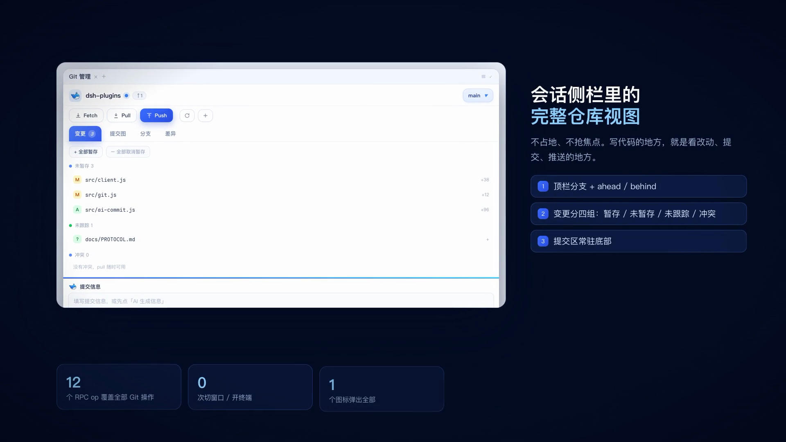
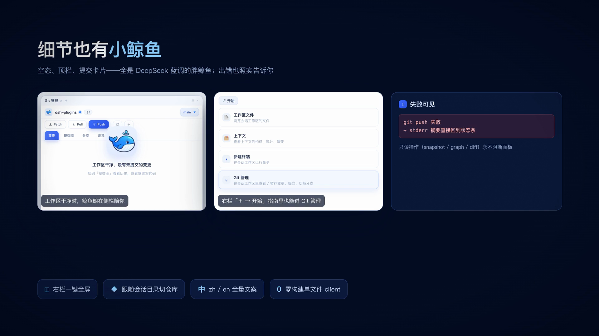

# dsh-next-git 宣传片（video/）

给 [`@caozeal/dsh-next-git`](../dsh-next-git/README.md) 做的 38 秒产品宣传片：H.264 / 1920×1080 / 60fps，
带配乐与音效（AAC 192k）。

**「纯 mockup」版（可公开发布）**：`out/dsh-next-git-promo-mockup.mp4` —— 全片 UI 都是运行时
渲染的面板组件（`src/core/ui.js` 里的 `MockPanel` 等），**不含任何真机截图或会话画面**，
所以可以放心放在任何公开位置。配乐同为 ACE-Step，−14.7 LUFS / 真峰 −1.0 dBFS。

保留版（含已打码的真机截图，内部使用）：`out/dsh-next-git-promo.mp4`，两个备选（同画面，仅换音轨）：

| 文件 | 配乐 | 响度 |
| --- | --- | --- |
| `out/dsh-next-git-promo-mockup.mp4` | **ACE-Step 生成 · 纯 mockup** ← 对外发布用 | −14.7 LUFS / −1.0 dBFS |
| `out/dsh-next-git-promo.mp4` | 同一配乐 · 含真机截图（内部） | −14.7 LUFS / −1.0 dBFS |
| `out/dsh-next-git-promo-synth.mp4` | 程序化合成（numpy/scipy 硬编码音效点） | −15.3 LUFS / −1.5 dBFS |
| `out/dsh-next-git-promo-silent.mp4` | 无音轨，方便另外配音 | — |

ACE-Step 那条见 [`audio/acestep/README.md`](audio/acestep/README.md)（含 4 个候选的试听
文件与生成/配速命令）。

### 在线站点（播放页 + 在线 Demo）

目标地址：**<https://dsh.caozeal.cn/next-git/>**，Demo 在 `/next-git/demo/`。

站点由 `video/pages.mjs` 一次生成，内容 = 播放页 + 在线 Demo + 插件真实 client.js：

```bash
node video/pages.mjs video/site
npx wrangler deploy --config video/wrangler.toml
```

产物结构（`video/site/`，已 gitignore）：

```
index.html        播放页
demo/             在线 Demo（index.html + host-shim.js + boot.js + fixtures.json）
lib/client.js     插件真实前端代码，demo 按 ../lib/client.js 引用
poster.png        封面
```

为什么用 Worker 的 route 而不是 Cloudflare Pages：Pages 项目占据的是**主机名根**，
没法只挂 `/next-git` 这种子路径；Worker route 可以精确匹配
`dsh.caozeal.cn/next-git/*`，`video/worker.js` 负责把该前缀剥掉后交给静态资源。

前置条件：`dsh.caozeal.cn` 在 Cloudflare 里有一条 **proxied（橙色云）** 的 DNS 记录，
且 zone `caozeal.cn` 托管在 Cloudflare（NS: `elly.ns.cloudflare.com`）。

本地联调（不需要登录）：

```bash
node video/pages.mjs video/site
npx wrangler dev --config video/wrangler.toml --port 8787
# 打开 http://127.0.0.1:8787/next-git/ 与 /next-git/demo/
```

旧地址 **<https://dsh-next-git.1017835747.workers.dev/>** 仍在，内容是早前手工上传的
播放页（不含 Demo），保留作备用。

- 站点手工上传，**改片后要重新生成站点并重传**：
  `node video/pages.mjs /tmp/cf-site`，再把 `video/out/*.mp4` 放进 `/tmp/cf-site/video/out/`
- 已知限制：Cloudflare 静态托管**不响应 Range 请求**（实测 Workers 与 Pages 都是整包返回），
  所以拖动进度条会从头下载；38 秒片子影响有限
- GitHub Release `v0.1.4` 的附件保留了同一份 mp4，可作为下载备份

`out/`、`audio/*.wav`、`audio/acestep/*.flac` 都在 `.gitignore` 里（都能本地重新生成，
成片改一版就翻倍，不适合进 git）。进仓库的是：渲染器源码 `src/`、素材 `assets/`、
预览帧 `docs/`、配乐脚本，以及 `audio/acestep/listen/` 那 5 个候选试听 mp3（每个约 0.9 MB，
本来就为试听而存在）。成片要分发时放 GitHub Release 附件。


| 帧 | 内容 |
| --- | --- |
|  | 片头：插件图标 + 一句话价值主张 + 安装命令 |
|  | 会话侧栏里的完整仓库视图（mock 渲染） |
|  | AI 生成 Conventional Commits 提交信息 |
|  | 鲸鱼娘空态 / 右栏指南 / 失败可见 |
|  | 三步安装 + npm / GitHub / MIT |

## 分镜

| # | 时长 | 画面 | 要点 |
| --- | --- | --- | --- |
| 01 | 4.6s | 片头 | 「把 Git 搬进会话侧栏，让 AI 帮你写提交信息」 |
| 02 | 4.6s | 痛点对比 | 终端 5 步来回切窗口 → 侧栏 5 步不离开会话 |
| 03 | 4.2s | 入口 | 会话头部 Git 图标 / 右栏「+ → 开始」→ Git 管理 |
| 04 | 3.4s | 面板总览 | 真机截图 + 三块卖点 |
| 05 | 3.0s | 分支 | 本地/远程分支、ahead/behind、跟踪分支 |
| 06 | 3.0s | 变更 | staged / unstaged / untracked / conflicted 四组 |
| 07 | 3.0s | Diff | hunk 逐行渲染、旧新行号、增删配色 |
| 08 | 4.4s | AI 提交信息 | diff + 历史风格 → 一行 subject，可编辑，降级兜底 |
| 09 | 4.0s | 提交图 | SVG lane、分支标签、点击看该 commit 的 diff |
| 10 | 3.6s | 细节 | 鲸鱼娘空态、右栏指南入口、失败可见、全屏、zh/en |
| 11 | 4.2s | 收尾 | 3 步安装 + 安装命令 + 仓库链接 |

## 怎么改再渲染

渲染器是一套「无构建依赖」的 CSS/SVG 动效页面：`bun` 把 `.jsx`（classic runtime，JSX → `h()`）
转成浏览器模块，Chrome 渲染，`agent-browser` 逐帧 seek 截图，`ffmpeg` 合成 60fps 视频。

```bash
cd video
./render.sh            # 全流程：构建 → 起服务 → 逐帧截图 → ffmpeg 出 out/dsh-next-git-promo.mp4
```

- 需要：`bun`、`ffmpeg`、`agent-browser`（`npm i -g agent-browser && agent-browser install`）。
- 配乐两条路线都要跑：`audio/acestep_fit.py`（默认，即定稿音轨）与
  `audio/synth.py`（程序化合成，见 [`audio/README.md`](audio/README.md)）。ACE-Step 需要
  mini 上的 ComfyUI，步骤见 [`audio/acestep/README.md`](audio/acestep/README.md)；scripted
  那条的音效点是硬编码的，改分镜时要同步改。
- 逐帧截图放在 `/tmp/dsh-next-git-promo-frames`（可用 `FRAMES_DIR` 改），约 1100 张 PNG / 400MB。
- 时间轴在 [`src/core/timeline.js`](src/core/timeline.js)：`dur` 是场景自身动画时长，`slot` 是它在
  成片里占的时长（渲染器用动画 playbackRate 拉伸），`XFADE` 是交叉淡入时长。
- 只重编码（帧已缓存）：`FRAMES_DIR=/tmp/dsh-next-git-promo-frames node encode.mjs`
- 单场景预览：`node server.mjs` 后打开 `http://127.0.0.1:8899/?capture=1&t=12.5`（拖进度条的
  非 capture 模式也支持，点画面播放）。
- 视觉：`src/core/engine.js`（基础样式、pop 入场 helper），`src/core/stage.js`（背景/光晕/网格），
  `src/core/ui.js`（面板 UI 的 CSS mock，配色对齐 DeepSeek 蓝 `#3b6bff`）。

## 素材

`assets/` 全部来自仓库自身，没有外部版权素材：

- `icon.png`：插件图标（`dsh-next-git/icon.png`）
- `whale.png`：小鲸鱼贴纸（从 `lib/client.js` 的 `WHALE_IMG` 抽出并放大）
- `shot-*.png`：`dsh-next-git/test/live/artifacts/` 里的真机验证截图（已打码）

因为截图里有打码区，画面用「白色卡片 + 侧栏内容」的构图，把打码区留在视觉边缘。